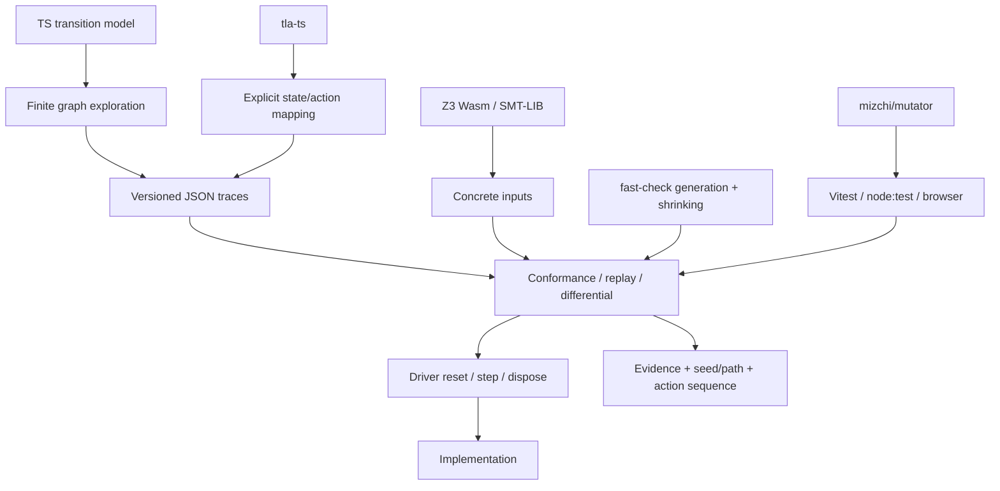

# 設計

モデルと実装を結ぶ共通境界は「操作」「観測」「トレース」。ソルバーがテストランナーを呼ぶ構造を避け、どの環境でも同じ比較処理を使う。

## コントラクト

`Model` は純粋で、状態・操作・観測を変更しない。`key(state)` は将来の有効操作、遷移、観測、不変条件を決定する全状態を識別する。観測が同じという理由で異なる内部状態を統合してはいけない。ハッシュの衝突を許容する API ではない。

`Driver` は実装を操作し、変更されない観測スナップショットを返す。比較で扱う JSON 値への抽象化はここで行う。時間、乱数、通信、永続化を制御する必要がある場合は、その実装の依存をドライバーで差し替える。共通コアはホスト環境を仮定しない。`dispose()` は1回の検査を終えるので、PBT では毎回新しいドライバーを生成する。

非決定的適合性は候補集合を保つ。初期観測に一致する初期状態から始め、操作で遷移し、実観測に合う successor のみを残す。空集合になった最初の位置で失敗する。これは有限操作列に対する存在的な履歴一致で、分岐するモデル間の simulation relation の構成ではない。

`ConformanceResult.trace` は実際に観測した履歴。失敗した実装の履歴を新しい正解オラクルとして採用しない。失敗を再現するときはその操作列を元のモデルと再比較する。`checkModel` の witness、TLA+ のモデル実行、信頼した reference driver の履歴がオラクルの出所になる。

## ソルバー境界

TLA+ の状態やラベルから実装操作への対応は呼び出し側が明示する。表示ラベルからの推測や、TLA の値をそのまま JSON として扱う変換を組み込まない。モデルの不変条件違反と実装の適合性違反は別の結果として記録する。

Z3 アダプターには SMT-LIB の assertion と取得する Int 定数を渡す。結果は SAT / UNSAT / UNKNOWN。UNKNOWN を合格や UNSAT として扱わない。1つのアダプター内の呼び出しは直列化する。ランタイムを共有する別アダプターの同時実行は、呼び出し側で管理する。Z3 の初期化・ワーカー・終了処理もホスト側が所有する。

TLA+ と SMT-LIB を共通の暗黙的数値型に変換しない。有限モデルは明示した領域、Z3 の Int は無制限整数、tla-ts の算術は利用バージョンの互換範囲に従う。将来 BMC を加える場合は、有限集合、整数上限、bit-vector の wraparound、未定義演算を IR で宣言する必要がある。

## 探索と性能

現段階は正確な文字列キーによる visited 集合と BFS。深さと状態数を必須にし、有限化の根拠をモデルに置く。テスト例の探索操作ではリクエスト ID を2種類、キューを2件に制限する。ドライバーへの直接入力はより広い領域を扱える。

スケールさせる際は、まず以下を個別に測定する。

| 対象                 | 次の変更                                 | 正確さの条件                                  |
| -------------------- | ---------------------------------------- | --------------------------------------------- |
| witness の保持       | 親ポインターと操作で保持し、必要時に復元 | 反例と replay 結果が一致する                  |
| 長い実行の履歴コピー | 内部バッファへ追記して返却時に固定       | 公開スナップショットを変更しない              |
| 状態同一性           | intern、整数 ID、構造共有                | 衝突時に構造比較する                          |
| 大きい有限領域       | 状態の対称性による代表化                 | 観測と検査する性質を保存する                  |
| 重複スケジュール     | 独立性を宣言した POR / DPOR              | 有効性、観測、fairness / cycle 条件を保存する |
| ランダム探索の偏り   | corpus と因果順序の feedback             | 予算内の探索として報告する                    |

ブラウザの UI を応答可能にするには検査を Worker へ移す。試作のブラウザテストは小さいモデルをページ内で実行する。並列化や近似 fingerprint によって先に正確さの前提を増やさない。
